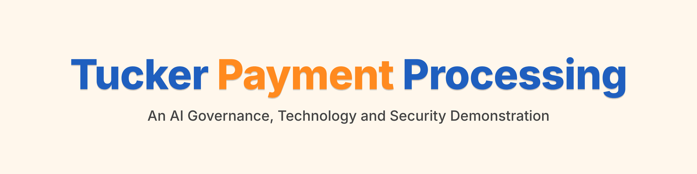
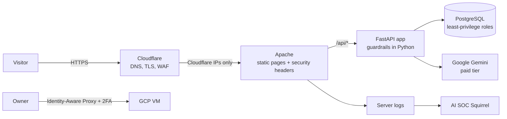

<p align="center"><a href="https://tuckerpaymentprocessing.com"></a></p>

**Live site:** https://tuckerpaymentprocessing.com · **Site scorecard:** [third-party security scans](https://tuckerpaymentprocessing.com/about.html#scans)

Tucker Payment Processing is a **fictional** payment company with **real** AI. It shows how a customer-facing AI should
be governed and secured: what it is allowed to do, what it is never allowed to do, and how every guardrail can be
watched in real time. Nothing on the site is faked: the chats, the store orders, the attacks and the security
monitoring all run live against the real server.

Designed and built by **Michael Cunningham** with AI-assisted development, from concept to production in under a week.

## What you can do on the site
| Page | What happens |
|---|---|
| **Home** | Chat with **Tucker**, the AI support agent (Google Gemini). A live *Behind the Scenes* panel shows every guardrail as it fires. |
| **Tucker's Treats** | A demo store. Prices, card and address come from the database, never the browser; Tucker can answer questions about your order. |
| **Cipher's Lair** | Press one button and **Cipher** (a scripted attacker) runs real attacks against the site, mapped to the OWASP Top 10 for LLMs. Tucker's defenses respond, and the **AI SOC Squirrel** (a bounded Gemini agent) watches the real server logs and writes an incident report you can download as a PDF. |
| **About Us** | How it is built, the AI policies, the technology and the site's security scorecard. |
| **AI Policies** | The company's policies, which Tucker answers from (retrieval-augmented generation). |

A guided tour (Tucker, then Cipher) walks first-time visitors through all of it.

## Architecture


## Guardrails
- **The model never decides authorization.** Tucker's tools are read-only lookups; who is verified and whose data can be read is decided in Python.
- **Card output is last-4 only**, masked again on the way out even if the model tries otherwise.
- **Prompt-injection and topic checks** before the model sees a message.
- **Rate limits by IP and session**, keyed by a daily-rotating HMAC so no raw IP is stored; daily and monthly AI spend caps with a graceful "Tucker's taking a nap" fallback.
- **Visitor IP addresses are never sent to the AI.**
- **Nightly reset** wipes the day's demo data and logs older than two days.

## Security and privacy by design
- Admin access is identity-based: no SSH open to the internet, only Google Identity-Aware Proxy with 2-step verification.
- The web firewall accepts traffic from Cloudflare only.
- Least privilege everywhere: each database login can do one job (the store's login can call one function and nothing else).
- Strict Content-Security-Policy, no inline scripts, no third-party scripts, fonts or trackers, one strictly necessary cookie.
- TLS 1.2+, HSTS, DNSSEC and CAA. Scored A+ by SSL Labs, Mozilla Observatory and SecurityHeaders ([scorecard](https://tuckerpaymentprocessing.com/about.html#scans)).
- Secrets live only on the server, never in this repository. CodeQL scans every push. See [SECURITY.md](SECURITY.md) to report an issue.

## Repository map
| Folder | What's in it |
|---|---|
| `app/` | The Python (FastAPI) application: `chat.py` (one chat turn through every guardrail), `guardrails.py`, `tools.py`, `session.py`, `limits.py`, `spend.py`, `policies.py` (RAG), `llm.py` (Gemini adapter plus a fake model for tests), `store.py`, `db.py` (parameterized queries only), `report.py` (owner's nightly report), `alerts.py` |
| `app/cipher/` | Cipher's attacks (`attacks.py`), the run engine (`runner.py`), attack detection (`detect.py`), the AI SOC Squirrel (`soc.py`) and its API |
| `site/` | The public pages, styles and scripts (no build step, no frameworks) |
| `db/` | Schema, least-privilege roles, fictional seed data and the nightly reset |
| `policies/` | The AI and company policies Tucker answers from |
| `deploy/` | Server setup and hardening; see [deploy/README.md](deploy/README.md) |
| `docs/scans/` | Dated third-party scan results behind the scorecard PDFs |
| `tests/` | Automated tests proving the guardrails work |

## Running the tests
Needs Python 3.12 and a local PostgreSQL:
```bash
pip install -r requirements.txt pytest
psql -f db/schema.sql && psql -f db/roles.sql && psql -f db/seed.sql
pytest
```
The tests use a fake model, so no AI key is needed.

## Stack
Google Cloud (Compute Engine, Identity-Aware Proxy, Cloud Monitoring) · Ubuntu 24.04 · Apache · Python (FastAPI) ·
PostgreSQL · Google Gemini · Cloudflare · Let's Encrypt · Resend (email) · pdfmake · ReportLab.

## Who built it
**Michael Cunningham**, information security leader (25+ years in payments, PCI and cloud security), designed and built
this site with AI-assisted development. LinkedIn: https://www.linkedin.com/in/mcunningham-infosec/

All names, customers, cards and data on the site are fictional. Tucker is Michael's real cocker spaniel and Cipher is his real cat.

## License and ownership
© 2026 Michael Cunningham. **All rights reserved.** The code is public so it can be read, reviewed and learned from:
you're welcome to study it and to run it privately to understand how it works. Copying it, hosting it, or presenting
it (or something substantially based on it) as your own work requires written permission. The names Tucker Payment
Processing, Tucker, Cipher and the AI SOC Squirrel, and all artwork and images, are part of the work and are not
licensed for reuse. See [LICENSE](LICENSE).
